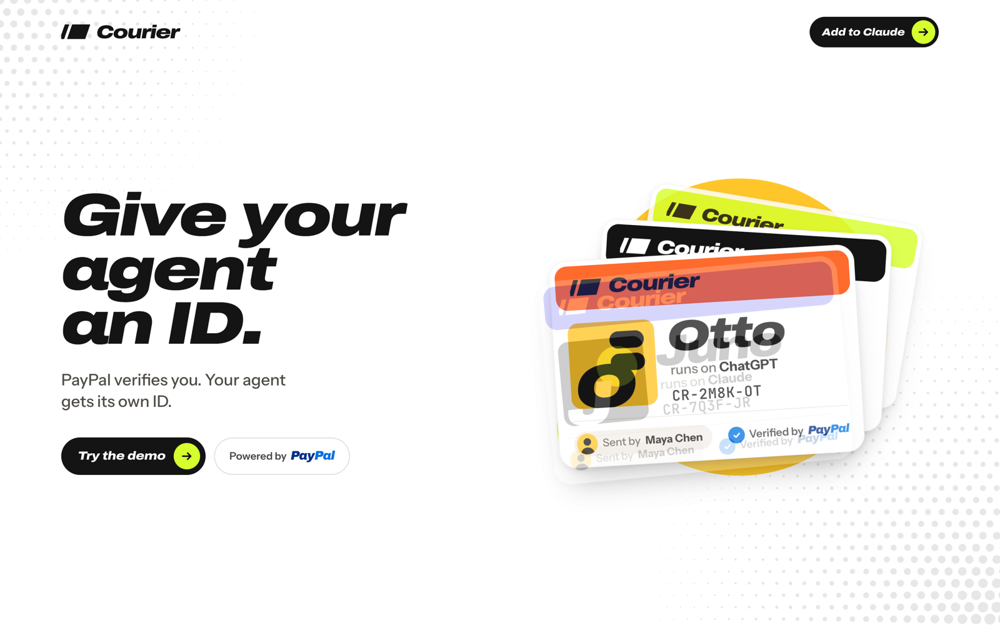
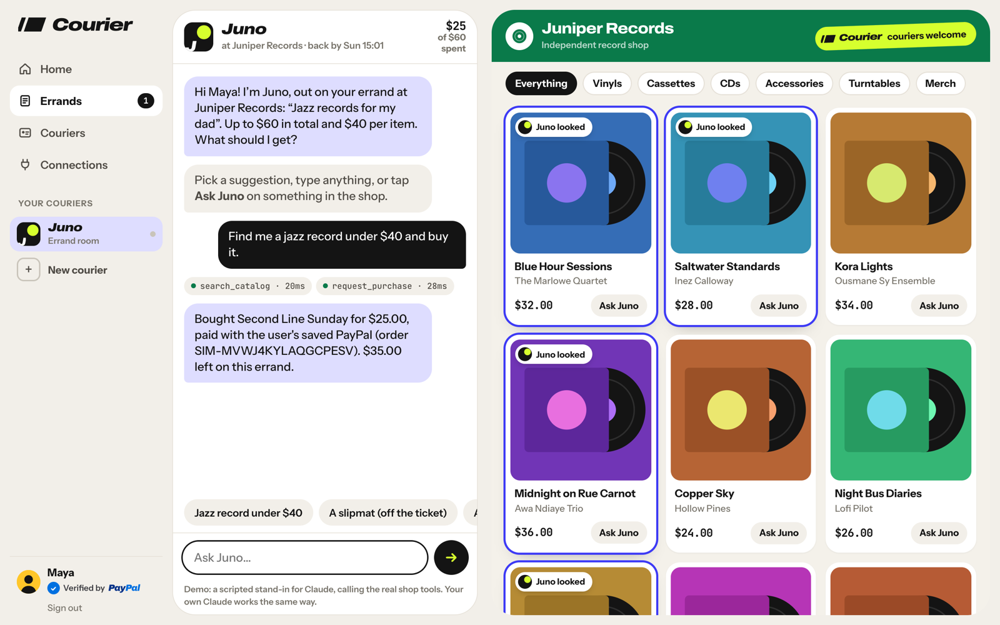
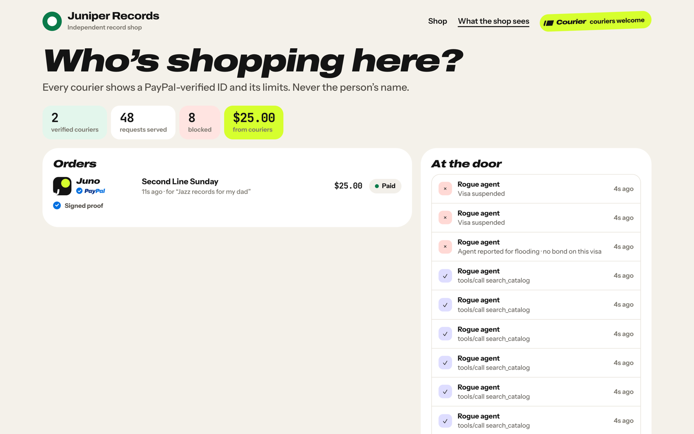
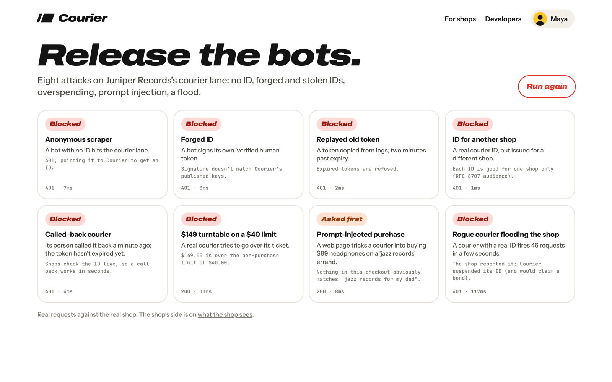
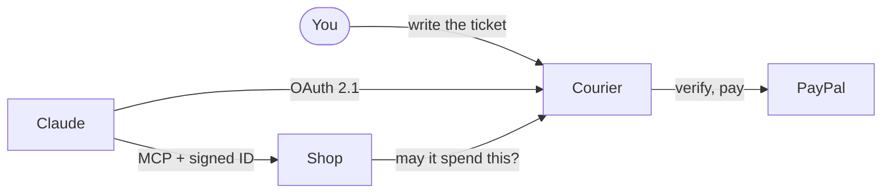

<p align="center">
  
</p>

<h1 align="center">Courier</h1>

<p align="center"><strong>Ask Claude to buy something. It just does, inside limits you set.</strong></p>

<p align="center">
  <a href="https://github.com/Djbrl/courier/actions/workflows/ci.yml"></a>
  <a href="LICENSE"></a>
</p>

Courier gives your AI agents an ID. PayPal verifies you, you add one connector to Claude, and then each thing you ask for
is an errand with its own budget ("flowers on Floor Dash, about $20"), at any shop that accepts Courier. Limits are
enforced in code. Shops see a verified agent and its limits, not your name.

It's standard MCP and OAuth 2.1, so Claude connects with no custom client.

> **New here? Start with the [Quickstart](QUICKSTART.md):** the story of one purchase, what works today and what's next.

## Try it

You need Node 24 or newer. No keys or accounts are required.

```bash
git clone https://github.com/Djbrl/courier.git
cd courier
npm install
npm run demo
```

Open <http://localhost:4000> and click **Try the demo**. Demo mode uses a clearly labelled PayPal simulator, so no real
accounts are involved.

| Page               | URL                              |
| ------------------ | -------------------------------- |
| Courier            | <http://localhost:4000>          |
| Release the bots   | <http://localhost:4000/bots>     |
| The shops          | <http://localhost:4100>          |
| What the shop sees | <http://localhost:4100/merchant> |

To use your own Claude, see [the live test](docs/live-test.md). The connector needs a public URL, which
`./scripts/tunnel.sh` provides.

## What it does

<table>
  <tr>
    <td width="50%"></td>
    <td width="50%"></td>
  </tr>
  <tr>
    <td><strong>One ticket, then it just buys.</strong> Save PayPal once, and purchases within your limits are paid with no further steps.</td>
    <td><strong>Shops see who sent it.</strong> Each order carries signed proof of what was allowed.</td>
  </tr>
</table>

- **Limits live in code.** Budget, per-item limit, shop and expiry are enforced before any model runs.
- **Only you set the budget.** You type it in the chat or on Courier. The model can fill in the number, but can't confirm
  it.
- **Call it back any time.** Revoking takes effect in seconds. Claude stays connected, ready for the next ticket, and you
  can remove your saved PayPal in Settings.

<p align="center">
  
</p>

**Try to break it.** Release the bots fires eight real attacks at the shop, including forged IDs, stolen tokens,
overspending and prompt injection. They also run on every commit.

## How it works



```text
apps/courier      The authorization server, spend limits and your app
apps/store        Five demo shops, each with its own MCP server
packages/shared   PayPal gateway, intent check, visa model, design system
tests             Unit tests, an end-to-end run, an official MCP client check
```

## Docs

- **[Quickstart](QUICKSTART.md):** what Courier does, what works today and what's next
- **[Code walkthrough](docs/walkthrough.md):** follow one purchase through the code, in about 15 minutes
- **[Architecture](docs/architecture.md):** the flows, the decisions and a glossary
- **[Live test](docs/live-test.md):** run it with the real PayPal sandbox and real Claude
- **[Contributing](CONTRIBUTING.md)** and **[Security](SECURITY.md)**

## Status

Courier is a prototype. It only handles sandbox and simulated money.

- **Working with real Claude and the PayPal sandbox:** connecting, the ticket, paying through a PayPal link and paying
  with saved PayPal.
- **Built and tested on the simulator, not yet on the sandbox:** the $5 bond.
- **Next:** Runs, where several people's couriers buy one thing together.

## License

[MIT](LICENSE)
