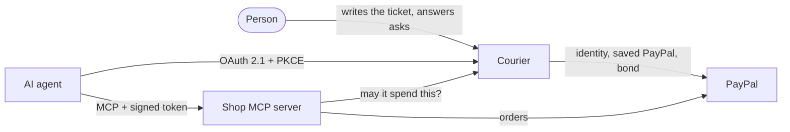
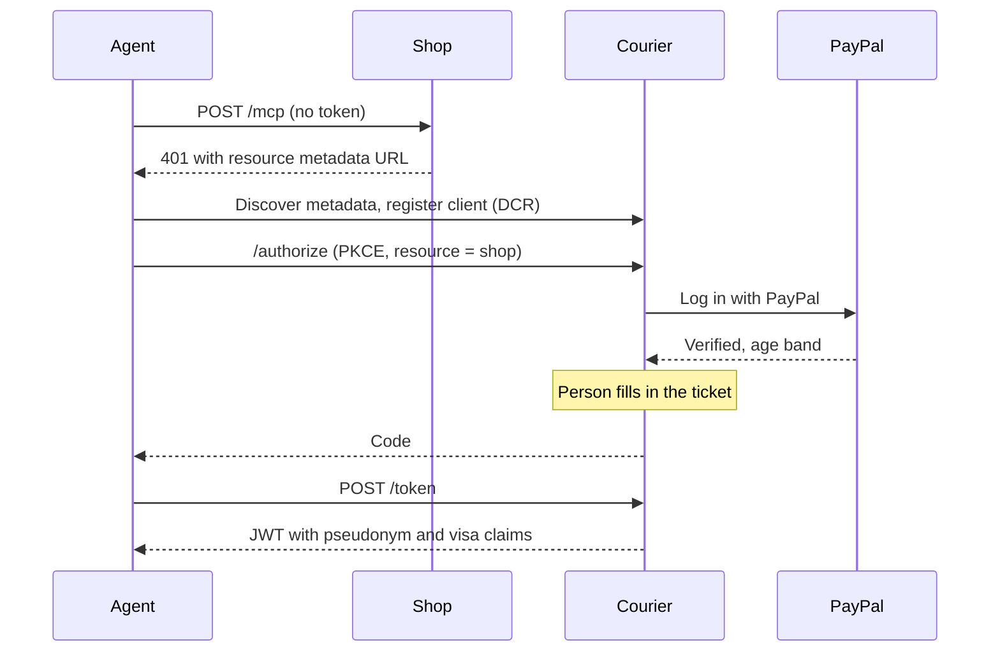
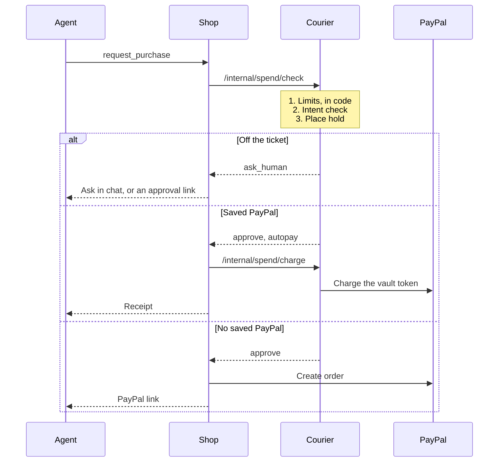

# Architecture

Courier is an OAuth 2.1 authorization server for AI agents. A verified person gives their agent a scoped, spend-limited,
expiring permission for one shop. Shops accept it through standard MCP auth, so there's no new protocol to adopt.

## Glossary

| Term             | Meaning                                                                                                              |
| ---------------- | -------------------------------------------------------------------------------------------------------------------- |
| **Courier**      | The product and `apps/courier`. Also the name for a person's agent, such as "Juno"                                   |
| **Errand**       | What the person sees: a job for a courier, written on a ticket                                                       |
| **Visa**         | What the code sees: the signed, limited permission behind an errand. Carried in the access token                     |
| **Stamp**        | One entry in an errand's step-by-step record                                                                         |
| **Hold**         | Budget set aside while a payment is pending, so parallel purchases can't overspend                                   |
| **Approval**     | A question to the person, created when a purchase is off the ticket                                                  |
| **Bond**         | An optional refundable $5 PayPal authorization. It's voided on a clean finish and captured if the shop reports abuse |
| **Saved PayPal** | A PayPal Vault token that lets an errand pay without a PayPal page. Courier keeps it, never the shop                 |

## The packages

| Path              | Role                                                                                          |
| ----------------- | --------------------------------------------------------------------------------------------- |
| `apps/courier`    | Authorization server, spend authority, the person's app, PayPal simulator                     |
| `apps/store`      | Juniper Records, the demo shop: MCP server (OAuth resource server), storefront, merchant view |
| `packages/shared` | Config, PayPal gateway, intent check, visa model, document store, design system               |

The two apps are separate processes that share no database. They talk over HTTP: the shop verifies tokens against
Courier's public keys and calls `/internal/*` with a shared secret. Today Courier knows one shop. Adding more means a merchant registry and per-shop API credentials.

## Connecting

Claude finds Courier by itself, starting from the shop's MCP URL.

## Buying

## Decisions worth knowing

**Limits run before the model.** `/internal/spend/check` rejects anything over a limit in plain code. Only then does the
intent check run, and it can only answer `approve`, `ask_human` or `deny`. A prompt-injected agent can fool a model, but
it can't raise a limit.

**Intent check backends fall through.** Jev, then Claude, then deterministic rules, so the product works with no model
key. A blank purpose skips the check, since anything within the limits is what the person asked for.

**The token isn't enough.** Tokens are self-contained, but the shop also asks Courier for the visa's live status (cached
briefly), so a call-back takes effect in seconds rather than at token expiry.

**Pseudonyms are per shop.** The token's `sub` is an HMAC of the person and the shop, so two shops can't compare notes.

**One yes covers the errand.** An approval is keyed to its items, so a hold and the later purchase of the same record
don't ask twice.

**The simulator has the same shape as PayPal.** `SandboxPayPal` and `SimulatedPayPal` implement one `PayPalGateway`. The
rest of the code can't tell which it's using, and the e2e runs without credentials.

## Storage

`DocStore` keeps JSON documents in SQLite, using Node's built-in `node:sqlite`: one `docs` table with `collection` and
`id` keys, one database file per app. It's small on purpose for a prototype, and it would be replaced by Postgres before
running more than one instance.

## Standards

OAuth 2.1 with PKCE · Dynamic Client Registration (RFC 7591) · Client ID Metadata Documents · Resource Indicators
(RFC 8707) · Protected Resource Metadata (RFC 9728) · Authorization Server Issuer Identification (RFC 9207) · JWT access
tokens signed with EdDSA · MCP elicitation for in-chat questions.
